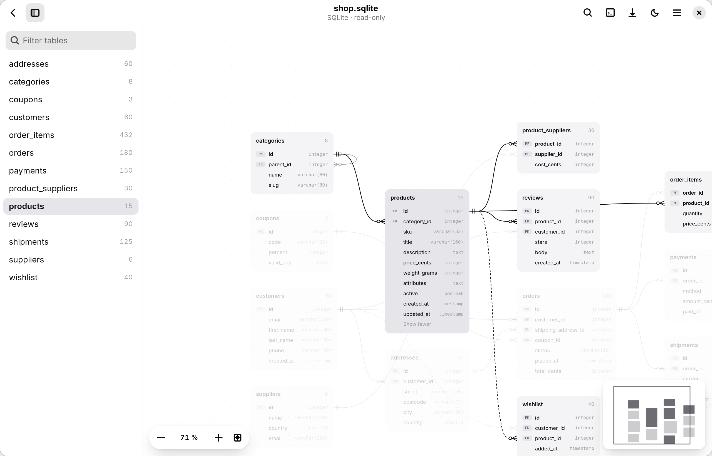
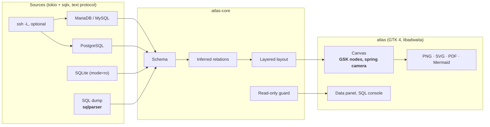
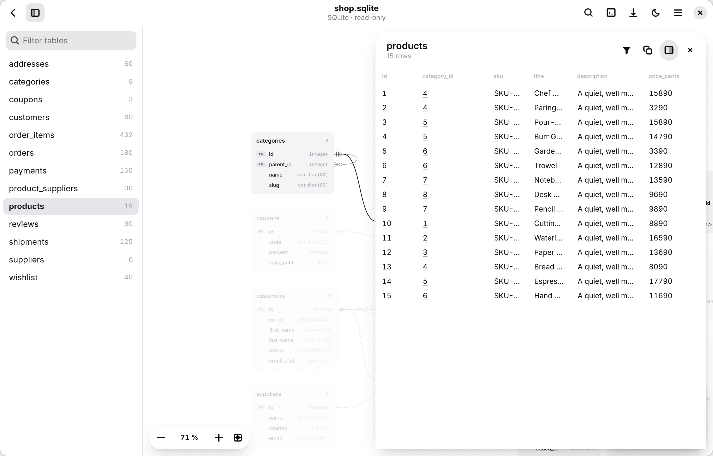
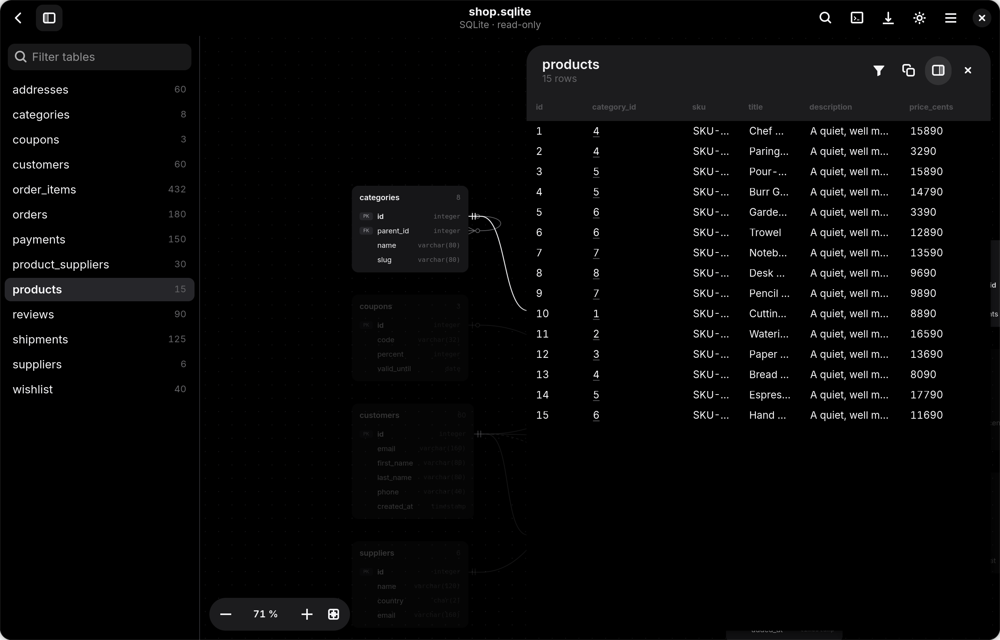
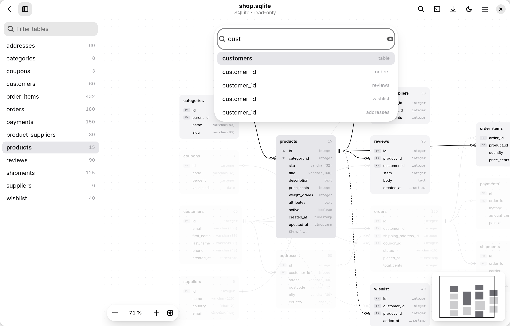
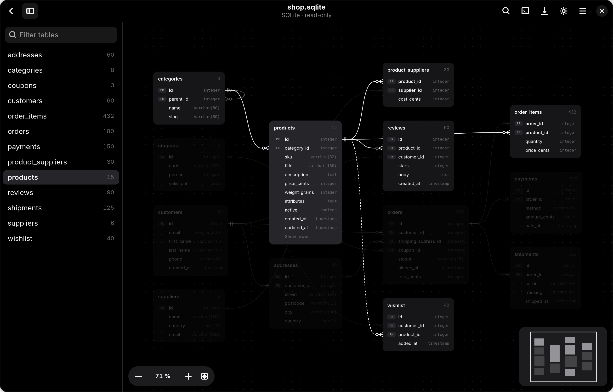
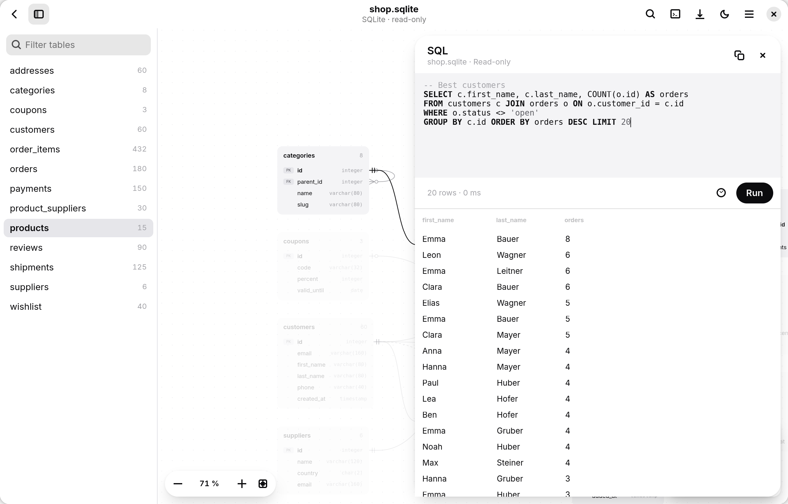
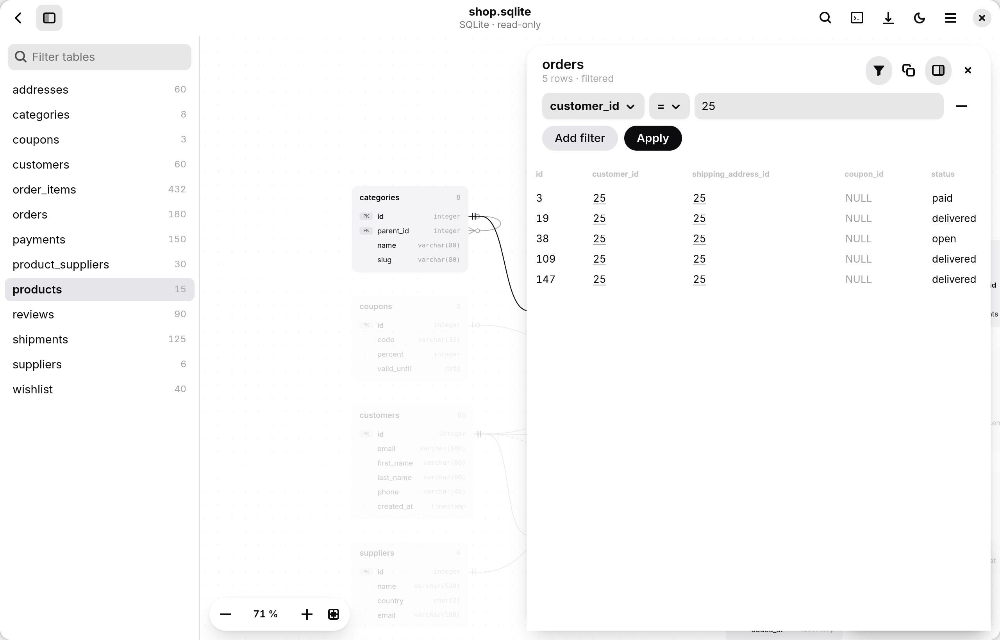
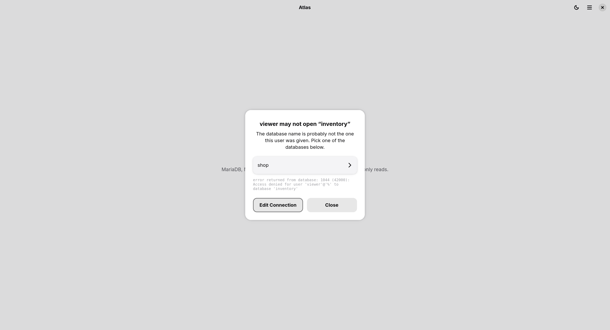
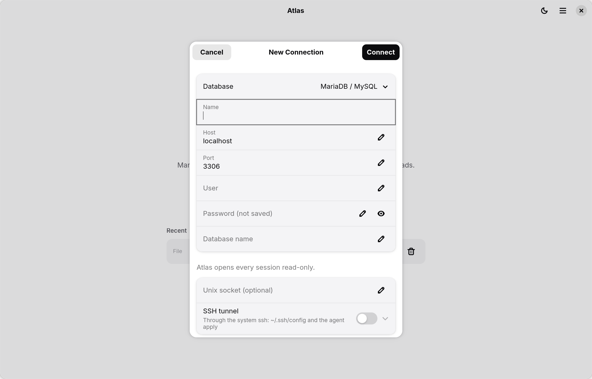

<div align="center">
  
  <h1>Atlas</h1>
  <p><strong>A light ER diagram and database viewer for Linux. It draws the tables of a MariaDB, MySQL, PostgreSQL or SQLite database, or of an SQL dump, as cards you can zoom and move, and shows their rows. It only reads.</strong></p>

  <p>
    
    
    
    
    
    
    
  </p>
</div>

---



---

Every claim below says how it is known: *tested* (and how), *built* (it compiles and runs, but was not tried that way) or *planned*. All GUI checks ran on **Fedora 44** (GNOME 50, Wayland, NVIDIA RTX 4070) in the installed Flatpak, through Atlas's own screenshot mode, which drives the app by its actions; nobody has yet used it by hand with a mouse and touchpad.

---

## Architecture Overview

**Atlas** is two crates. **`atlas-core`** holds everything that is plain data (schema model, inference, layout, springs, SQL building and checking, dump parsing, Mermaid, stored formats, design tokens) and is tested without a display. **`atlas`** is the GTK application.



More in [docs/ARCHITECTURE.md](docs/ARCHITECTURE.md), [docs/RENDERING.md](docs/RENDERING.md), [docs/MOTION.md](docs/MOTION.md), [docs/DESIGN.md](docs/DESIGN.md) and [docs/BUILD.md](docs/BUILD.md).

---

## Core Capabilities

- **Live Databases:** **MariaDB** and **MySQL** (information_schema), **PostgreSQL** (pg_catalog, the session's current schema), **SQLite** files. *Tested* by `cargo test` against **MariaDB 10.11** and **PostgreSQL 17** in containers and against an SQLite file: tables, columns, primary and unique keys, foreign keys, row counts, paged and filtered rows.
- **SQL Dumps:** `mariadb-dump`, `mysqldump`, `pg_dump` (with `COPY` blocks and `ALTER TABLE … ADD CONSTRAINT`), `sqlite3 .dump` or a hand-written `schema.sql`, read without a server. Only `CREATE TABLE` and `ALTER TABLE` are parsed, so a dump's INSERTs cost nothing. *Tested* by unit tests and on the `schema.sql` of a real web shop (10 tables).
- **Read-Only for Real:** every session is read-only on the server (**MariaDB** `SET SESSION TRANSACTION READ ONLY`, **PostgreSQL** `default_transaction_read_only`, **SQLite** `mode=ro`). The SQL console also refuses anything that is not a single reading statement before it is sent, including `SET SESSION TRANSACTION READ WRITE`. *Tested*: an `UPDATE` fails on all three databases.
- **Errors in Plain Words:** a failed connection says what is wrong (wrong database name, wrong password, user not allowed from this host, nothing listening, unknown host, timeout, SSH) with the server's own message below. When the database name was the problem, it lists the databases this user may open; one click connects to it. The connection form has the same list beside the database name. *Tested*: the classification by unit tests; the list against MariaDB 10.11, PostgreSQL 17 and a real MariaDB 11.8 (a wrong database name offered the right one); the dialog by screenshot in English and German.
- **Passwords Never Stored:** asked on every connect, dropped with the connection. Connections are kept without them. *Tested* (unit test on the stored format).
- **SSH Tunnel:** optional per connection, through the system's `ssh`, so `~/.ssh/config` aliases, `ProxyJump`, the agent and `known_hosts` apply as in a terminal. Unknown host keys are refused. *Built*, not yet tried against a server.
- **ER Diagram:** cards with **PK/FK** marks and types in **Geist Mono**, **crow's-foot** lines from the foreign key row to the referenced row (one, zero-or-one, zero-or-many from nullability and uniqueness). *Tested* (screenshots, unit tests of the ends).
- **Inferred Relations:** `kunde_id` → `kunden.id`, `customerId` → `customers`, `parent_category_id` → `categories`, drawn **dashed**, for databases without declared keys. **Ctrl+I** turns them off. *Tested* (unit tests, demo database).
- **Layout:** parents left of children, crossings reduced by barycentre sweeps, separate parts packed; cards can be dragged and keep their place per database. **Tidy Up** lays everything out again on springs. *Tested* (unit tests; positions restored in a second run).
- **Zoom and Move:** like Figma. Two fingers or the wheel move, pinch or **Ctrl+wheel** zoom toward the pointer, the middle button drags, a fling carries on and slows down. *Built*: the code paths ran only through actions, not through a real touchpad.
- **Motion:** springs from **Islands** for unfolding a card (cards below move with it), focus fading the unrelated tables, the camera flying to a table, the data panel growing out of its card, and a cross-fade between light and dark. Nothing ticks at rest. *Tested* by screenshots during and after the motion; the feel at full frame rate is not judged yet.
- **Navigation:** table list with row counts and a filter, **Ctrl+K** search over tables and columns, arrow keys to the next connected table, a **minimap** that moves the view on click. *Tested* (screenshots).
- **Data Browser:** 200 rows at a time as you scroll, sort by clicking a header, filters per column (contains, =, ≠, <, >, NULL), foreign key values as links to the referenced row, a detail column that pretty-prints JSON, copy as **CSV** or **SQL INSERT**. *Tested*: paging, filters and counts by `cargo test`, the panel and a filtered table by screenshots.
- **SQL Console:** **Ctrl+E**, **Ctrl+Enter** runs, the first 1,000 rows, a history per database, SQL highlighting in black and white. *Tested* (screenshot of a real query and its result).
- **Export:** **PNG** (2x), **SVG** and **PDF** (vectors, through cairo) and **Mermaid** `erDiagram` for READMEs and Obsidian. *Tested*: all four written from the demo database and opened.
- **Light and Dark:** follows the system, the header button flips it. *Tested* (screenshots).
- **English and German:** after the system language (or `LANGUAGE`). The translations ship inside the app, not as a separate Flatpak locale extension. *Tested*: 148 of 148 strings, the connection error dialog looked at in German; the other screens not yet.

| Light | Dark |
| :--- | :--- |
|  |  |
|  |  |
|  |  |
|  |  |

---

## Platform Support Matrix

| **System** | **Desktop** | **Status** |
| :--- | :--- | :--- |
| **Fedora 44** | GNOME 50, Wayland | *tested* (Flatpak installed and driven) |
| **CachyOS** | any | *planned*: same Flatpak, not run |
| **Linux Mint** | Cinnamon, X11 | *planned*: same Flatpak (X11 fallback socket), not run |
| **Debian stable** | GNOME | *planned*: needs `apt install flatpak` and Flathub first |
| **Ubuntu** | GNOME | *planned*: same Flatpak, not run |
| **macOS, Windows** | | not planned (GTK and Flatpak are the point) |

---

## Keyboard Shortcuts

| **Linux** | **Action** |
| :--- | :--- |
| **Ctrl + K** | Go to a table or column |
| **Ctrl + E**, **Ctrl + Enter** | SQL console, run |
| **Two fingers**, **wheel** / **Shift + wheel** | Move the view |
| **Pinch**, **Ctrl + wheel**, **Ctrl + +/−** | Zoom toward the pointer |
| **Ctrl + 0** / **Ctrl + 1** | Show everything / actual size |
| **Arrow keys** | Next connected table in that direction |
| **Space** | Unfold or fold the focused table |
| **Enter**, **double click** | Rows of the focused table |
| **Esc** | Close search, then the panel, then the focus |
| **F9** | Table list |
| **Ctrl + L** | Tidy up the layout |
| **Ctrl + I**, **Ctrl + M** | Inferred relations, minimap |
| **F5** | Reload the structure |
| **Ctrl + Shift + L** | Light or dark |
| **Ctrl + O**, **Ctrl + N**, **Ctrl + W** | Open a file, new connection, close the database |

---

## Data Storage & Disk Paths

Everything Atlas keeps is a plain file in its Flatpak config folder; delete the folder to start fresh.

| **File / Directory** | **Description** |
| :--- | :--- |
| **`~/.var/app/io.github.tomsliikee.Atlas/config/atlas/connections.json`** | Saved connections, never a password |
| **`…/atlas/recent.json`** | The last 8 files opened |
| **`…/atlas/layouts/<hash>.json`** | Card positions, unfolded cards and camera per database |
| **`…/atlas/history/<hash>.json`** | The last 100 console queries per database |
| **`…/glib-2.0/settings/keyfile`** | Theme, window size, minimap, inferred relations |

---

## Building and Running

**1. Install the GNOME 51 SDK and the Rust extension** (Flathub must be set up as a remote):
```bash
flatpak install --user flathub org.gnome.Sdk//51 org.gnome.Platform//51 org.freedesktop.Sdk.Extension.rust-stable//26.08
```

**2. Clone the repository:**
```bash
git clone https://github.com/tomsliikee/atlas.git
cd atlas
```

**3. Build and install the Flatpak:**
```bash
flatpak-builder --user --install --force-clean build-dir build-aux/io.github.tomsliikee.Atlas.json
```

**4. Run:**
```bash
flatpak run io.github.tomsliikee.Atlas
```

The GTK code builds only inside the SDK. `cargo test` for **`atlas-core`** runs on the host. Tests, the screenshot mode and the database containers are in [docs/BUILD.md](docs/BUILD.md).

---

## Limits

- Lines are curves between card sides; they can pass behind other cards in dense diagrams.
- PostgreSQL shows one schema (the session's `search_path`), not several at once.
- A dump shows structure only; its rows are not loaded.
- A Unix socket is only reachable when its folder is shared into the Flatpak with `flatpak override --user --filesystem=<folder> io.github.tomsliikee.Atlas` (Fedora's MariaDB uses `/var/lib/mysql/mysql.sock`). *Not tested*; TCP to `localhost` works without it.

---

## License

Distributed under the **MIT License**. See [`LICENSE`](LICENSE) for complete terms. **Inter**, **Geist Serif** and **Geist Mono** are under the **SIL Open Font License 1.1** (`insights-mono/fonts/`).
