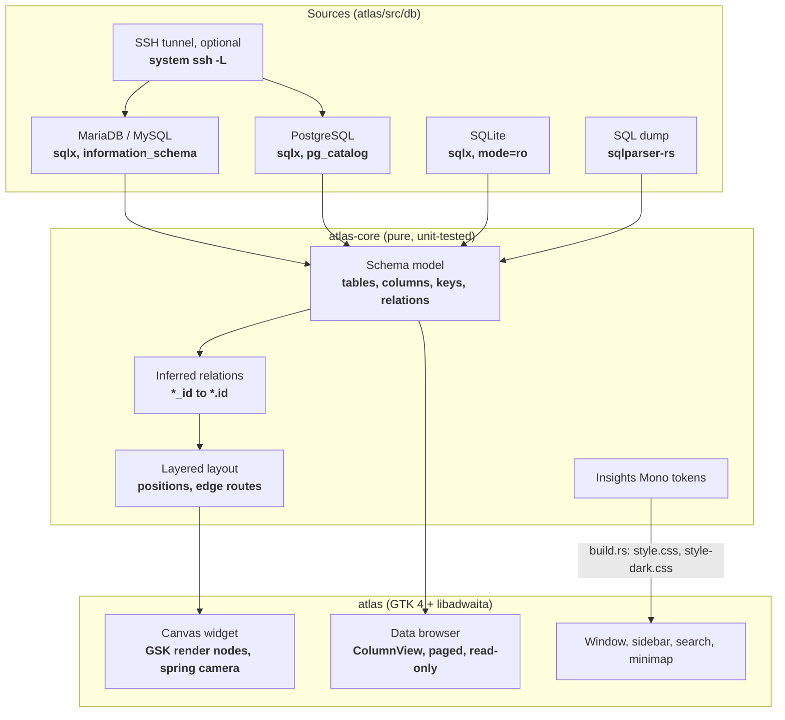

# Architecture

**Atlas** is a **Rust** application on **GTK 4** and **libadwaita**, shipped as a **Flatpak** on the **GNOME 51** runtime. It is split in two crates so that everything that is plain data can be tested without a display or a database.

| Crate | Holds | Tested on the host |
| :--- | :--- | :--- |
| **`crates/atlas-core`** | schema model, relation inference, layered layout, springs, SQL building, read-only guard, dump parser, Mermaid, stored formats, design tokens | **yes**, `cargo test -p atlas-core` (34 tests) |
| **`atlas`** | the GTK application: sources (`db/`), canvas (`canvas/`), window and panels (`ui/`), export | inside the Flatpak SDK (no GTK headers on the host); `db/tests.rs` runs against SQLite always, MariaDB and PostgreSQL when given |

---

## Principles

- **Read-only for real:** every live session is opened read-only on the server side (**MariaDB** `SET SESSION TRANSACTION READ ONLY` in `after_connect`, **PostgreSQL** `default_transaction_read_only = on` as a startup option, **SQLite** `mode=ro`). The console's guard (`atlas-core::guard`) refuses everything but one reading statement before it is sent, so a session can never be switched back. *Tested*: `db/tests.rs` sends an `UPDATE` to all three and expects an error.
- **Text all the way:** Atlas sends plain SQL text, no prepared statements. The MySQL text protocol and PostgreSQL's simple query protocol return every value as text, which is what a viewer shows; SQLite values are turned into text by their storage class. One code path reads catalogs, pages and console results alike.
- **Values never raw:** filter values reach MariaDB as `CONVERT(X'…' USING utf8mb4)`, PostgreSQL and SQLite as quoted strings with `standard_conforming_strings` on. Identifiers are quoted per dialect. *Tested* (unit tests, and a filter with a quote against all three databases).
- **The UI never waits:** database work runs on a two-thread **Tokio** runtime (`runtime.rs`); the UI awaits it inside `glib::spawn_future_local`. Late answers to an old query are dropped by a generation counter.
- **Passwords are never stored:** asked on every connect and dropped when the connection closes. Connections, layouts and console history are JSON in the app's config folder, written through a temporary file.
- **SSH through the system:** `ssh -N -L` with `BatchMode=yes` and `ExitOnForwardFailure=yes`; Atlas waits until the forwarded port accepts, or reports ssh's own error. The Flatpak gets the agent socket and `~/.ssh` read-only.
- **Cheap frames, nothing at rest:** see [RENDERING.md](RENDERING.md) and [MOTION.md](MOTION.md).

## Where Things Are

| Path | Holds |
| :--- | :--- |
| **`atlas/src/db/`** | `mysql.rs`, `postgres.rs`, `sqlite.rs` (connect, catalog, cell to text), `ssh.rs`, `tests.rs` |
| **`atlas/src/canvas/`** | `mod.rs` (widget, camera, gestures, animation), `card.rs` (measure and draw a card), `edges.rs` (anchors, curves, crow's feet) |
| **`atlas/src/ui/`** | `window.rs` (everything wired together, panel growth), `start.rs`, `connect.rs`, `sidebar.rs`, `search.rs`, `minimap.rs`, `data.rs` (rows and console), `grid.rs`, `export.rs` |
| **`atlas/src/shots.rs`** | the screenshot walk-through (`ATLAS_SCREENSHOT`) |
| **`data/`** | stylesheet template, GSettings schema, desktop file, metainfo, icons, SQL highlighting and its two colour schemes |
| **`po/`** | `atlas.pot`, `de.po`; `tools/update-po.sh` refreshes both |
| **`tests/fixtures/`** | the demo shop (`demo.sql`, `demo-data.sql`) |
